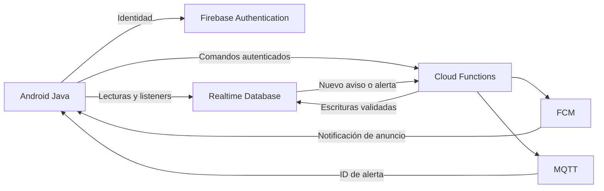

# Arquitectura

> **Referencia histórica.** Para los componentes y flujos de la entrega Spark, consulta [Arquitectura técnica](ARQUITECTURA_TECNICA.md).

## Cliente Android

`MainActivity` organiza el espacio protegido, la navegación inferior, los accesos directos desde FCM y el ciclo de vida MQTT. Los fragmentos usan XML, ViewBinding y componentes Material. Los listados usan RecyclerView y DiffUtil.

| Componente | Responsabilidad |
| --- | --- |
| `viewmodel/SessionViewModel` | Auth, correo verificado, perfil y pertenencia. Gestiona listeners y resultados obsoletos. |
| `viewmodel/FeedViewModel` | Estado, escucha en vivo y páginas históricas de los listados. |
| `viewmodel/OperationViewModel` | Ejecuta una mutación por formulario. Conserva el ID durante reintentos. |
| `viewmodel/AlertChannelViewModel` | Recibos MQTT y estado de la conexión. |
| `data/CommunityRepository` | Firebase Auth, consultas RTDB y funciones invocables. |
| `data/AlertSubscription` | MQTT TLS en hilo de trabajo, QoS 1 y reconexión. |
| `domain` | Normalización, validaciones y porcentajes. |
| `ui/FormDialog` | Entrada accesible, confirmación, carga y errores. |
| `services/CommunityMessagingService` | Canal, token y notificación con destino concreto. |

## Servidor

1. Auth establece la identidad y verifica el correo.
2. Realtime Database autoriza lecturas por UID, comunidad, membresía, rol y forma de consulta.
3. `functions/index.js` despacha comandos definidos. `access.js` resuelve autorización, `records.js` gestiona registros, `polls.js` conserva votos privados y `delivery.js` conecta FCM y MQTT.
4. La función devuelve un ID persistido y las pantallas reciben los cambios por RTDB.
5. Los eventos RTDB enlazan anuncios a FCM y alertas a MQTT. El suscriptor MQTT recibe el ID y obtiene el detalle desde su lectura autorizada.

Las mutaciones por ID usan transacciones. La boleta y la revisión de la encuesta viven en el mismo registro privado. La proyección pública avanza por revisión monotónica. Los privilegios requieren membresía administrativa y claims de la misma comunidad.

Si aumenta el volumen, la evolución propuesta es separar las colas de entrega, definir retención y ejecutar pruebas de carga con volúmenes representativos.
